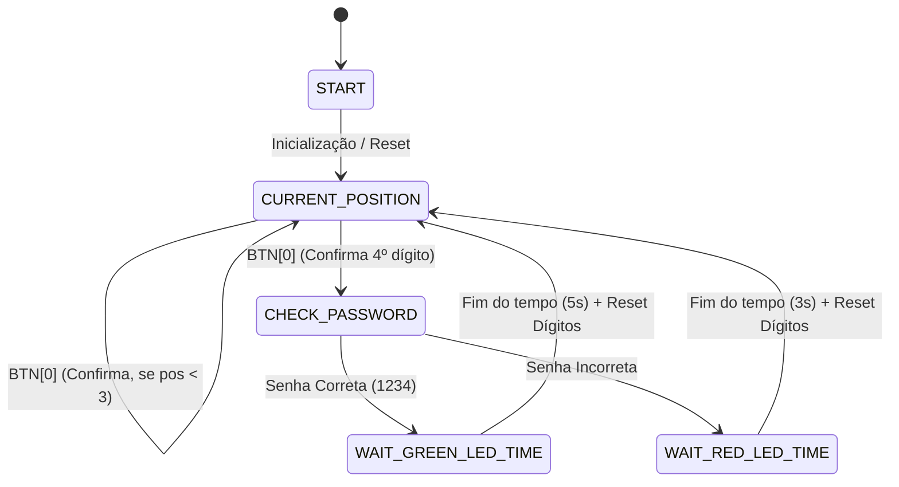

# SafeCrackPro

Uma implementação em FPGA de um cofre digital utilizando Máquina de Estados Finitos (FSM) em SystemVerilog. O sistema permite ao usuário inserir uma senha de 4 dígitos utilizando botões push-button, exibe o progresso em displays de 7 segmentos e fornece feedback visual de sucesso ou falha através de temporizadores e LEDs (Verdes para acesso concedido, Vermelhos para acesso negado).

## Índice
1. [Integrantes do Grupo](#integrantes-do-grupo)
2. [Implementação dos Requisitos](#implementação-dos-requisitos)
3. [Diagrama de Estados](#diagrama-de-estados)
4. [Diagramas de Tempo da Simulação](#diagramas-de-tempo-da-simulação)
5. [Bugs Conhecidos](#bugs-conhecidos)

---

## Integrantes do Grupo
* [Lucas Alves Barbosa] - [lab10]
* [Thales Vinícius Gomes Fraga] - [tvgf]
* [Nome do Integrante 3] - [Matrícula/Papel]

---

## Implementação dos Requisitos

O sistema foi desenvolvido seguindo uma arquitetura modular em SystemVerilog. Abaixo estão detalhadas as abordagens técnicas utilizadas para cumprir os requisitos do projeto:

* **Top-Level Design (`safecrackpro_top`)**: Atua como o maestro do projeto, interligando a FSM aos periféricos da placa FPGA (Clock de 50MHz, chaves, botões, LEDs e displays HEX). Ele mapeia a lógica interna para os pinos físicos.
* **Máquina de Estados Finitos (FSM)**: Utiliza a codificação *One-Hot* para otimizar o uso de recursos na FPGA. A FSM gerencia o fluxo desde o repouso (`START`), a navegação pelos 4 dígitos, a verificação da senha e os estados de temporização.
* **Detecção de Borda (Edge Detection)**: Como a FPGA opera em 50MHz, os botões foram condicionados através de um registro de estado anterior (`btn_prev`) comparado com o estado atual (`btn_pos`). A lógica `btn_pos & ~btn_prev` garante que cada clique físico resulte em exatamente um pulso lógico de 1 ciclo de clock, evitando saltos duplos nos displays.
* **Controle Numérico em Loop**: A lógica de edição nos estados de `CURRENT_POSITION` inclui *wrap-around*. Se o usuário tenta incrementar o dígito `9`, ele volta para `0`. Se tenta decrementar `0`, ele vai para `9`.
* **Temporização (Timers)**: Para evitar o uso de contadores externos complexos, a temporização dos LEDs foi embutida na FSM através do registrador `led_time_cnt`. Utilizando o clock padrão de 50MHz, foram parametrizados tempos exatos de 5 segundos (`250_000_000` ciclos) para a senha correta e 3 segundos (`150_000_000` ciclos) para a senha incorreta.
* **Sincronismo de Saída**: Os registradores da FSM limpam os dígitos e a posição no exato instante em que o tempo de LED finaliza, garantindo que a FSM não transite para o próximo estado com dados residuais da tentativa anterior.

---

## Diagrama de Estados

Abaixo está o comportamento lógico da máquina de estados (FSM) que controla o fluxo principal do projeto:

## Diagramas de Tempo da Simulação

Os diagramas abaixo foram gerados no ModelSim através do arquivo `tb_safecrackpro_top.sv` e atestam o comportamento elétrico/temporal da FSM mediante estímulos de teste.

> 
> *Imagem 1: Waveform no ModelSim
